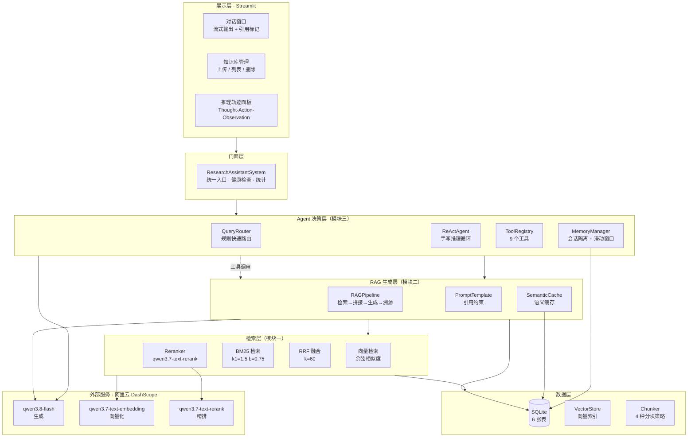
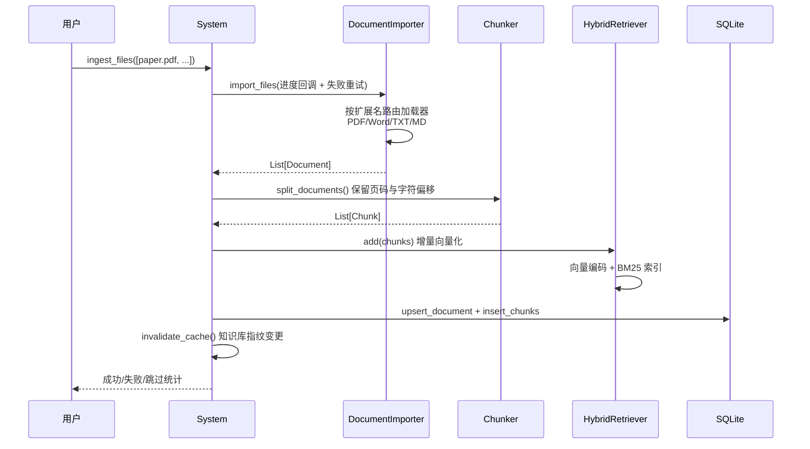
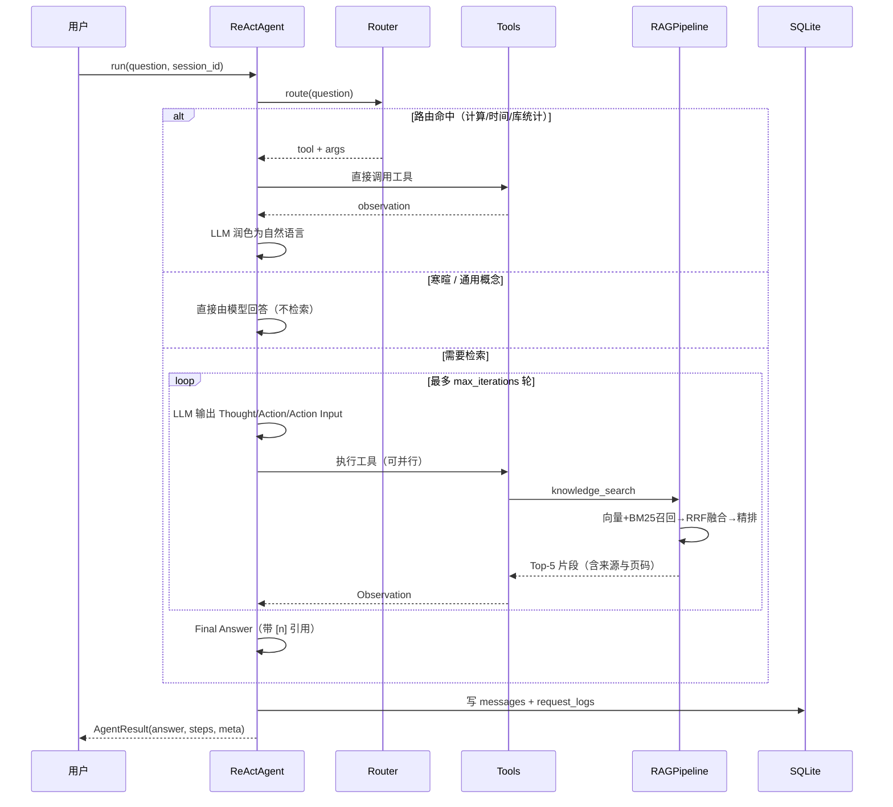

# 智能科研助理 —— 技术设计文档

> 基于 RAG + Agent 的论文知识库问答系统
> 版本 v1.0 · 南京农业大学《生产实习》课程项目

---

## 一、系统架构

### 1.1 整体架构图



### 1.2 分层职责

| 层次 | 核心模块 | 职责 | 可替换性 |
|---|---|---|---|
| 展示层 | `src/frontend/` | 三栏交互、流式渲染、轨迹可视化 | 可换 Gradio / FastAPI |
| 门面层 | `src/system.py` | 装配全部组件，对外唯一入口 | 稳定 |
| Agent 层 | `src/agent/` | 意图路由、ReAct 推理、工具调度、记忆 | 工具可插拔 |
| RAG 层 | `src/generation/` | 上下文拼接、生成、引用溯源、缓存降级 | 可换框架实现 |
| 检索层 | `src/retrieval/` | 双路召回、RRF 融合、精排 | 后端可换 FAISS |
| 数据层 | `src/data_loader/` `src/chunking/` `src/storage/` | 文档解析、分块、SQLite 持久化 | 分块策略可配置 |

### 1.3 设计原则

1. **单一模型接入**：LLM / Embedding / Rerank 统一走 DashScope，无多 provider 分支，
   配置与代码路径最简（用户明确要求）。
2. **依赖注入**：`RAGPipeline(retriever, llm, embedder, db)` 全部外部传入，
   测试时可用 Stub 替换，27 个单元测试完全离线运行。
3. **降级不中断**：在线服务失败时逐级降级（Rerank→启发式、流式→整段、
   检索无结果→纯模型生成），任何单点故障都不导致系统不可用。
4. **存储分层**：SQLite 存完整历史（永不裁剪），内存工作集做滑动窗口，
   裁剪只影响送给模型的内容，不丢用户记录。

---

## 二、模块接口定义

### 2.1 门面层：`ResearchAssistantSystem`

系统唯一对外入口，CLI / Web / 测试共用同一套 API。

```python
class ResearchAssistantSystem:
    def __init__(self, config=None, config_path=None, llm=None, embedder=None)

    # 知识库
    def ingest_files(paths, on_progress=None) -> dict   # 返回 success/failed/skipped/total_chunks
    def ingest_directory(dir_path, recursive=True) -> dict
    def delete_document(doc_id) -> dict
    def clear_knowledge_base() -> None
    def list_documents() -> list[dict]

    # 问答
    def ask(query, session_id="default", use_agent=True, on_step=None) -> dict
    def ask_stream(query, session_id="default") -> Iterator[dict]

    # 运维
    def health_check() -> dict      # LLM / 向量库 / Embedding / DB / 工具集
    def stats() -> dict             # 文档数 / 块数 / 缓存命中率 / Token
    def save_index(path=None) / load_index(path=None)
```

`ask()` 返回统一结构：

```python
{
  "answer": str,
  "citations": [{"index", "title", "page", "text", "score"}],
  "steps":     [{"iteration", "thought", "action", "action_input", "observation"}],
  "meta":      {"mode", "route", "iterations", "tool_calls", "latency", "tokens"}
}
```

### 2.2 检索层：`HybridRetriever`

```python
retriever = HybridRetriever(embedder=emb, config=cfg)
retriever.build(chunks)                    # 全量建库
retriever.add(chunks)                      # 增量入库（无需重建全量索引）
hits = retriever.search(query, top_k=20, final_top_k=5,
                        doc_filter=None, with_rerank=True)
# -> List[RetrievedChunk]，携带 vector_score / bm25_score / rrf_score / rerank_score
```

`RetrievedChunk` 保留完整打分链路，供前端可观测面板展示与 Bad Case 归因。

### 2.3 生成层：`RAGPipeline`

```python
rag = RAGPipeline(retriever=retriever, llm=llm, embedder=emb, db=db)
ans: RAGAnswer = rag.answer(query, history=None, use_cache=True, doc_filter=None)
for event in rag.stream_answer(query):
    event["type"]   # "meta" | "token" | "citation" | "done"
```

`RAGAnswer` 字段：`answer / citations / retrieved / latency / tokens /
from_cache / degraded / degrade_reason / hit_rate`。

### 2.4 Agent 层：`ReActAgent`

```python
agent = ReActAgent(llm=llm, tools=registry, memory=mem, config=cfg)
result: AgentResult = agent.run(query, session_id="s1", on_step=callback, force_agent=False)
```

`on_step` 回调在每一步推理后触发，前端据此实时渲染推理轨迹。
`force_agent=True` 可跳过路由，用于对比实验。

---

## 三、核心数据流向

### 3.1 文档导入流程



关键点：**导入是增量的**，新文档加入只需 `add()`，无需重建全量索引；
知识库指纹（`md5(文档ID列表 + 块数)`）变更时语义缓存整体失效，
避免"上传新论文后仍返回旧答案"。

### 3.2 问答流程（Agent 模式）



### 3.3 引用溯源链路

```
Chunk（含 doc_id + page）
  → 检索命中后编号 [1]..[5]
  → Prompt 中标注 "[1] 来源：标题（第N页）"
  → 模型输出句末带 [n]
  → parse_citations() 解析回真实来源
  → 前端渲染"引用来源"卡片
```

兜底机制：模型未按要求标注引用时，自动列出 Top-3 来源，
**保证任何回答都可追溯**。

---

## 四、数据模型（SQLite）

`data/assistant.db` 共 6 张表：

| 表名 | 主要字段 | 用途 |
|---|---|---|
| `documents` | doc_id, title, source, file_type, num_pages, num_chunks, status, meta | 论文元数据与索引状态 |
| `chunks` | chunk_id, doc_id, chunk_index, page, start_char, end_char, text | 文本块（溯源与摘要数据源） |
| `sessions` | session_id, title, summary, created_at, updated_at | 会话管理与摘要压缩 |
| `messages` | id, session_id, role, content, tokens, meta | 完整对话历史（永不裁剪） |
| `cache` | key, query, answer, citations, vector(BLOB), kb_version, hit_count | 语义缓存 |
| `request_logs` | type, query, answer, hits, steps, latency_ms, tokens, route, degraded | 评测与 Bad Case 分析 |

设计要点：

- `chunks.doc_id` 外键级联删除，删文档即删块
- `cache.vector` 以 float32 BLOB 存储，启动时载入内存工作集做相似度匹配
- `request_logs` 支持 SQL 直接聚合，模块五评测无需解析 JSONL：

```sql
SELECT type, COUNT(*) n, AVG(latency_ms), AVG(top1_score)
FROM request_logs GROUP BY type;
```

---

## 五、关键算法设计

### 5.1 RRF 融合（倒数排名融合）

```python
score(d) = Σ_i  w_i / (k + rank_i(d))      # k = 60
```

选用 RRF 而非分数加权的原因：向量余弦（0~1）与 BM25（0~20+）**量纲不同**，
直接加权需归一化且对参数敏感；RRF 只用"名次"，对量纲不敏感，鲁棒性更好。

### 5.2 BM25

```
score(Q,d) = Σ_t IDF(t) · [f(t,d)·(k1+1)] / [f(t,d) + k1·(1-b+b·|d|/avgdl)]
IDF(t)     = ln(1 + (N-df(t)+0.5)/(df(t)+0.5))
```

中文分词用 jieba，未安装时自动降级为 2-gram 滑窗。
BM25 的 IDF 依赖全局统计，`add()` 增量添加后自动重建（1 万块约 0.3s）。

### 5.3 ReAct 循环与容错

手写实现（约 200 行核心逻辑），四层容错：

| 机制 | 触发条件 | 处理 |
|---|---|---|
| 输出解析容错 | 模型未严格遵循格式 | 多前缀匹配（Thought/思考）、JSON 失败降级为裸 query |
| 工具重试 | 工具返回 `[错误]` | 最多 `max_tool_retries` 次重试 |
| 死循环检测 | 同一 (工具, 参数) 指纹重复 N 次 | 强制终止并用已有观察收敛答案 |
| 超迭代收敛 | 达到 `max_iterations` | 基于已收集 Observation 生成总结性回答 |

并行调用：模型输出 `Action: ["a","b"]` + `Action Input: [{},{}]` 时，
用线程池并发执行，降低端到端延迟。

### 5.4 记忆管理：滑动窗口 + 摘要压缩

```
SQLite(messages)  = 完整历史，永不裁剪   ← UI 展示与复盘
SessionMemory     = 工作集，按预算裁剪   ← 拼 Prompt
```

触发摘要压缩的条件：对话轮次 > `summarize_threshold`（默认 8），
保留最近 4 条消息，早期历史交给 LLM 压缩为摘要存入 `sessions.summary`。

### 5.5 语义缓存

新问题向量与历史问题比对，余弦 ≥ `similarity_threshold`（0.93）直接返回旧答案，
跳过整条 RAG 链路。命中时延迟从约 2s 降至 50ms、Token 消耗为 0。
`kb_version` 变更时整体失效，保证一致性。

---

## 六、降级与容错策略

| 故障点 | 降级行为 | 用户感知 |
|---|---|---|
| Rerank 接口失败 | 自动降级为本地启发式精排 | 无感，日志告警 |
| 流式输出失败 | 降级为整段返回后分片输出 | 打字机效果略有差异 |
| 检索无结果 | 纯模型生成 + "知识库未找到"提示 + 上传建议 | 明确提示 |
| 检索分数过低 | 带"可能不准确"警告 + 展示检索片段供确认 | 明确提示 |
| LLM 调用失败 | 友好错误提示 + 配置检查建议 + 已检索片段 | 不抛裸异常 |
| API Key 缺失 | 启动即给出三种配置方式指引 | 明确指引 |

---

## 七、配置说明（config.yaml）

| 配置项 | 默认值 | 说明 |
|---|---|---|
| `llm.model` | `qwen3.8-flash` | DashScope 生成模型 |
| `llm.api_key` | 空 | 留空则读 `.env` 的 `DASHSCOPE_API_KEY` |
| `embedding.model` | `qwen3.7-text-embedding` | 1024 维 |
| `retrieval.reranker.model` | `qwen3.7-text-rerank` | 注意 `gte-rerank` 已下线 |
| `storage.db_path` | `./data/assistant.db` | SQLite 路径（自动锚定到项目根） |
| `chunking.strategy` | `recursive` | 论文场景建议 `academic` |
| `retrieval.top_k` / `final_top_k` | 20 / 5 | 召回候选 / 进 Prompt 片段数 |
| `agent.max_iterations` | 6 | ReAct 最大轮次 |
| `cache.similarity_threshold` | 0.93 | 语义缓存命中阈值 |

所有参数支持环境变量覆盖，如 `APP_LLM__MODEL=qwen-max`。
相对路径（data / logs / index）统一锚定到项目根目录，不随运行目录漂移。

---

## 八、评测结果摘要

评测语料为 10 篇同方向论文（Transformer 系列），评测集 50 题
（事实性 20 / 归纳性 10 / 推理性 10 / 对比性 10）。

| 档位 | Hit@1 | Hit@3 | Hit@5 | MRR |
|---|---|---|---|---|
| 纯向量 | 0.920 | 0.980 | 0.980 | 0.947 |
| 混合检索(RRF) | 0.940 | 0.980 | 0.980 | 0.960 |
| 混合+重排序 | 0.960 | 0.980 | 0.980 | 0.970 |

详见 `reports/评测报告.html`。Hit@5 已饱和，故以 Hit@1 与 MRR 作为主指标。


