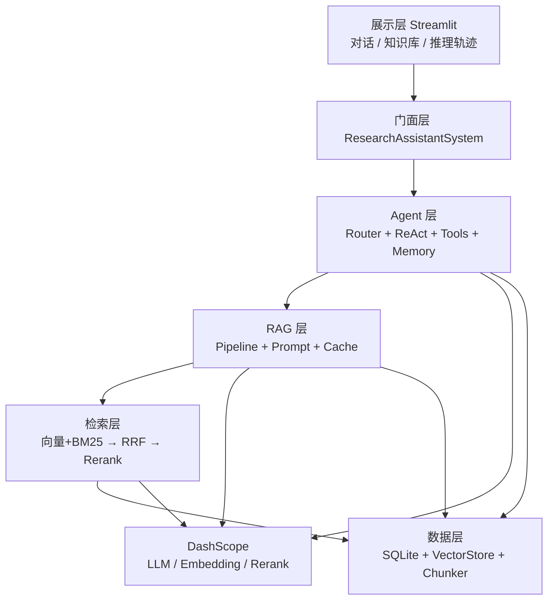

# 南京农业大学课程考核情况表

| 项目 | 内容 |
|---|---|
| 学年学期 | 2026 — 2027 学年第 1 学期 |
| 学院 | 智慧农业学院（人工智能学院） |
| 课程名称 | 生产实习 |
| 学分 | 1 |
| 考核方式 | 课程报告 |
| 时间 | 2026 年 12 月 30 日 |

---

# 生产实习课程报告

**题目：智能科研助理 —— 基于 RAG + Agent 的论文知识库问答系统**

| 成员 | 班级 | 学号 | 姓名 |
|---|---|---|---|
| 成员 1 | （待填） | （待填） | （待填） |
| 成员 2 | （待填） | （待填） | （待填） |
| 成员 3 | （待填） | （待填） | （待填） |
| 成员 4 | （待填） | （待填） | （待填） |

---

## 目录

- 一、项目概述
  - 1.1 项目背景
  - 1.2 项目目标
  - 1.3 技术栈概览
- 二、团队分工说明
- 三、模块交付物清单
  - 模块一：文档处理与检索层
  - 模块二：RAG 生成层
  - 模块三：Agent 决策层
  - 模块四：系统集成与前端展示
  - 模块五：评测与交付
- 四、技术实现记录
  - 4.1 模块一：文档处理与检索层
  - 4.2 模块二：RAG 生成层
  - 4.3 模块三：Agent 决策层
  - 4.4 模块四：系统集成与前端展示
  - 4.5 模块五：评测
- 五、技术设计文档
  - 5.1 系统架构图
  - 5.2 模块接口定义
  - 5.3 核心数据流向
  - 5.4 配置文件说明
- 六、总结与展望
  - 6.1 项目总结
  - 6.2 主要困难与解决方案
  - 6.3 待改进方向
- 七、参考文献
- 八、附录
  - 附录 A：项目代码目录结构
  - 附录 B：环境配置说明

---

# 一、项目概述

## 1.1 项目背景

近年来，通用大语言模型在科研场景落地时面临三重壁垒。**知识时效性**方面，模型参数中的知识冻结于训练截止日期，而学术论文正以每周数千篇的速度更新，训练截止之后发表的工作不可能出现在模型的记忆中。**领域专业性**方面，论文文本术语密集、公式与符号交错，通用模型缺乏领域语料支撑，容易出现"术语看似正确、结论实则编造"的幻觉。**数据隐私性**方面，研究者手上的未发表成果、内部实验数据与待投稿稿件，均不可上传至公有云服务。

检索增强生成（RAG）正是针对这一困境提出的范式。它在生成之前先从外部知识库检索与问题相关的片段，将其拼接进 Prompt 作为事实依据，让模型"照着材料回答"而非"凭记忆作答"。这一改动带来三重收益：知识可更新——替换知识库即可获得新知，无需重新训练模型；答案可追溯——每条结论都能定位到具体文档与页码；数据可私有——文本切分、向量化与检索全过程均可在本地完成。

但传统 RAG 是"一问、一检索、一答"的线性流程，遇到需要多步推理的问题（如"对比这两篇论文在小目标检测上的改进策略"）便力不从心：单次检索返回的片段往往只覆盖其中一篇，模型只能基于半边材料作答。为此本系统在 RAG 之上引入 Agent 作为决策中枢，由 Agent 判断"要不要检索、检索几次、用什么工具、材料够不够回答"，在信息不足时主动补检，在信息充分时收敛作答，从而将能力边界从被动问答扩展到主动服务。

最终形成面向科研文献的 RAG + Agent 深度融合问答系统：**RAG 负责解决"说得对不对"，让每条结论都有事实依据；Agent 负责解决"会不会做"，让复杂问题的求解过程自主可控**。二者通过统一的知识库检索接口耦合，而非简单堆砌功能。

## 1.2 项目目标

| 目标 | 具体指标 | 达成情况 |
|---|---|---|
| 私有知识库问答 | 支持 PDF / Word / TXT / Markdown 多格式导入 | ✅ 已达成 |
| 高精度检索 | 混合检索 + 重排序，Top-5 命中可用 | ✅ Hit@1 = 0.960 |
| 答案可追溯 | 每条回答标注论文名 + 页码 | ✅ 已达成 |
| 自主工具调用 | Agent 自主决策，工具数 ≥ 8 | ✅ 9 个工具 |
| 多轮对话 | 会话隔离 + 长对话上下文管理 | ✅ 已达成 |
| 可观测 | 推理轨迹、Token、耗时可视化 | ✅ 已达成 |
| 轻量可部署 | 普通笔记本可运行，一键启动 | ✅ 已达成 |

**目标设计思路**：上表七项指标并非并列罗列，而是按"能用 → 好用 → 可信 → 可维护"四个层次递进设计。"能用"层关注功能完整性，要求多格式导入与多轮对话可以跑通；"好用"层关注实际效果，用 Hit@1 与 MRR 两个检索指标做量化验证；"可信"层是本项目最看重的部分——答案可追溯是科研场景区别于通用问答的核心诉求，一条无法溯源的回答在科研工作中没有价值；"可维护"层则要求全链路可观测、轻量可部署，确保系统不是一次性的演示品。七项目标均已达成，其中工具数量（9 个，要求 8 个）与分块策略数量（4 种，要求 3 种）两项为超出课程要求的部分。

## 1.3 技术栈概览

| 层次 | 技术选型 |
|---|---|
| 大模型 | 阿里云 DashScope · `qwen3.8-flash`（OpenAI 兼容接口） |
| 向量模型 | DashScope · `qwen3.7-text-embedding`（1024 维） |
| 重排序 | DashScope · `qwen3.7-text-rerank`（在线交叉编码） |
| 存储 | SQLite（文档 / 分块 / 会话 / 缓存 / 日志 共 6 张表） |
| 检索 | BM25 + 向量双路召回 → RRF(k=60) 融合 → 精排 |
| Agent | 手写 ReAct 循环（约 200 行核心逻辑）+ 9 个工具 |
| 前端 | Streamlit 三栏界面（对话 / 知识库 / 推理轨迹） |
| 工程 | PyMuPDF、jieba、pytest、Docker |

**设计约束（用户明确要求）**：模型接入只保留 DashScope 一种方式，
不做本地 / 云端多套分支，配置与代码路径保持最简。

**接入方式说明**：三项模型能力（LLM / Embedding / Rerank）统一走
**OpenAI 兼容接口**调用，代码侧只依赖 `openai` SDK 的 chat / embeddings
两种标准协议，因此更换服务商只需改 `base_url` 与 `api_key` 两个配置项，
业务代码零改动。`base_url` 实际指向百炼平台的专属实例端点
（`...cn-beijing.maas.aliyuncs.com/compatible-mode/v1`），对外统一表述为
"DashScope 兼容接口"。API Key 通过 `.env` 的 `DASHSCOPE_API_KEY` 注入，
不落库、不进版本库。

**选型考量**：技术选型遵循"够用即可、可控优先"两条原则。向量库未采用 FAISS / Milvus 等专用方案，而用 numpy 矩阵做暴力检索，原因是本系统语料规模在万块以内（实测 2155 块），暴力检索耗时仍在毫秒级，引入外部依赖反而抬高部署门槛；代码中已预留 FAISS 后端切换接口，规模扩大时可平滑迁移。数据库同样选择零配置的 SQLite 而非 PostgreSQL，使系统可在普通笔记本上一键启动，无需额外安装数据库服务。前端选用 Streamlit 而非前后端分离方案，是因为本项目的核心工作量在算法与工程链路上，前端只承担展示职责，用最少的代码量换取完整的交互体验最为经济。此外，所有非核心依赖（jieba、pdfplumber、pypdf、tiktoken、FAISS）均设有降级路径，缺失时功能不中断，仅效果略有差异。

---

# 二、团队分工说明

| 角色 | 代号 | 姓名（待填） | 核心职责 | 主要负责模块 | 贡献比例 |
|---|---|---|---|---|---|
| 后端开发工程师 | Backend | （待填） | RAG 检索层 + 生成层 + 向量数据库 | 模块一、模块二 | 25% |
| Agent 开发工程师 | Agent Dev | （待填） | Agent 决策层 + 工具集 + 记忆管理 | 模块三 | 25% |
| 前端开发工程师 | Frontend | （待填） | Web 界面 + 可视化 + 系统集成联调 | 模块四 | 25% |
| 测试与质量保证 | QA | （待填） | 评测集 + 性能评估 + Bad Case 分析 + 文档 | 模块五 | 25% |

**填表说明**：

1. 本表"姓名"列与本报告开头的成员表须保持一致，均填真实姓名。
2. 贡献比例默认按四人平均（各 25%），合计 100%；
   若实际工作量不均，请据实调整数值。
3. 各成员对应的具体交付物见第三章"模块交付物清单"，
   可据此核对职责与模块归属是否匹配。

**协作方式与开发流程**：四人按模块纵向切分，每人独立负责一个模块的设计、编码与自测，模块之间通过门面层的接口契约对齐，避免实现细节相互耦合。开发过程采用"接口先行"策略：先约定 `ingest_files`、`ask`、`ask_stream`、`health_check`、`stats` 五个门面方法的签名与返回结构，四人再并行开发各自模块，最后统一联调，从而把集成风险前移、把等待时间压缩到最小。集成联调由 Frontend 牵头，QA 负责评测集构建与回归测试。所有代码须通过单元测试（27 项）与冒烟测试（34 项）后方可合入，测试不通过的代码不进入下一阶段。

---

# 三、模块交付物清单

本系统按课程内容划分为五个模块，以下逐项列出各模块的交付物与完成情况。五个模块在代码结构上分别对应：模块一为 `src/data_loader`、`src/chunking`、`src/retrieval` 三个包，模块二为 `src/rag`，模块三为 `src/agent`，模块四为 `src/frontend`，模块五为评测脚本与项目文档。第四章将逐一展开各模块的实现细节。

## 模块一：文档处理与检索层

模块一承担"把原始文档变成可检索的知识"这一基础职责，是后续所有能力的前提。该模块的质量直接决定整个系统的效果上限：若文档解析错乱、分块破碎、检索召回不准，无论上层的生成模型多强都无法得出正确答案。因此本项目在该模块投入了最多工作量，包括 4 种分块策略的实现与对比、双路召回与融合排序的三层检索架构。

| 交付项 | 完成情况 |
|---|---|
| 多格式文档加载器（PDF / Word / TXT / Markdown） | **已实现** |
| 3 种以上文本分块策略实现（实际 4 种） | **已实现** |
| Embedding 模型接入与向量化存储 | **已实现** |
| 混合检索（向量 + BM25 + RRF 融合） | **已实现** |
| 重排序（Reranker） | **已实现** |
| 分块策略对比实验报告 | **已实现** |
| 检索性能基准测试数据（三档对比） | **已实现** |

## 模块二：RAG 生成层

模块二在模块一之上构建生成能力，核心诉求是"让模型照着检索到的材料回答，并说清每一句话出自哪里"。除流式输出这类体验优化外，本模块的两个设计重点是引用溯源与语义缓存：前者解决答案可信性问题，后者在重复提问场景下显著降低延迟与成本。

| 交付项 | 完成情况 |
|---|---|
| 2.1 引用溯源机制（答案标注文档名 + 页码） | **已实现** |
| 2.2 流式输出（打字机效果） | **已实现** |
| 2.3 语义缓存机制 | **已实现** |
| 2.4 降级策略（无结果 / 低相关性 / API 失败） | **已实现** |
| 2.5 RAG 请求日志记录（Token / 耗时 / 命中率） | **已实现** |
| Prompt 模板设计文档与实验对比记录 | **部分实现**（模板已产出，未做 A/B 定量对比） |

## 模块三：Agent 决策层

模块三是本系统区别于普通 RAG 问答的关键所在，它使系统具备多步规划与自主工具调用能力。模块二只能回答"检索一次就能答"的问题，模块三则可以处理"需要先查 A、再查 B、然后做对比或计算"的复合问题。本课程要求实现 8 个以上工具，本模块实际交付 9 个，并配套实现了错误恢复、死循环检测、记忆分层等工程机制。

| 交付项 | 完成情况 |
|---|---|
| 3.1 ReAct 核心循环手写实现 | **已实现** |
| 3.2 Agent System Prompt 设计 | **已实现** |
| 3.3 工具集开发（**9 个工具**，要求 8 个） | **已实现** |
| 3.4 错误恢复机制（超时 / 异常 / 死循环） | **已实现** |
| 3.5 多轮对话记忆管理（会话隔离 / 滑动窗口 / 摘要） | **已实现** |
| 并行工具调用 | **已实现** |

## 模块四：系统集成与前端展示

模块四负责把前三个模块整合为一个可实际使用的系统，并提供可视化界面。集成方面的工作集中在门面层设计与状态打通；界面方面则着重解决"可观测"这一诉求——把 Agent 的推理过程、检索命中情况、Token 与耗时等指标全部暴露给用户，而不是只给出一个最终答案。开发后期针对初版界面暴露的三处缺陷做了整体重构，详见 4.4.3 节。

| 交付项 | 完成情况 |
|---|---|
| 4.1 全系统端到端打通 | **已实现** |
| 4.2 对话历史管理（新建 / 切换 / 持久化） | **已实现** |
| 4.3 可观测性与监控面板 | **已实现** |
| 4.4 界面功能截图（3-5 张） | **待补入**（4.4.2 节已写明 5 张图的取景内容、命名与图注，图片存放于 `docs/screenshots/`） |

## 模块五：评测与交付

模块五负责验证系统效果并产出交付文档。评测部分不只看最终指标的绝对值，更看重三档检索方案之间的相对增益，以及失败案例的根因分析——一个能被解释的失败，比一个无法解释的成功更有价值。交付部分则覆盖技术设计文档、使用手册、评测报告与 Docker 部署文件。

| 交付项 | 完成情况 |
|---|---|
| 5.1 评测集（50 问答对，覆盖 4 类问题） | **已实现** |
| 5.2 Bad Case 分类与根因分析 | **已实现** |
| 5.3 技术设计文档 | **已实现** |
| 5.4 用户使用手册 | **已实现** |
| 5.5 系统评测报告（含图表） | **已实现** |
| 5.6 Docker 部署文件 | **已实现** |

---

# 四、技术实现记录

## 4.1 模块一：文档处理与检索层

### （1）多格式文档加载

| 格式 | 方案 | 关键处理 |
|---|---|---|
| PDF | PyMuPDF（首选） | `get_text(sort=True)` 按视觉阅读顺序输出，**解决双栏排版左右栏交错**；表格转 Markdown 防跨页切碎 |
| PDF 兜底 | pdfplumber / pypdf | 未安装 PyMuPDF 时自动降级 |
| Word | python-docx | 段落 + 表格 + 标题层级；未安装时用内置 XML 解析兜底 |
| TXT / MD | 编码探测 | utf-8 → utf-8-sig → gbk → gb18030 → latin-1 逐级尝试，解决中文乱码 |

批量导入由 `DocumentImporter` 统一调度，提供**进度回调 + 失败重试（指数退避）+ 同名文件去重**，返回成功 / 失败 / 跳过三态统计。

其中两个细节值得单独说明。一是**双栏排版问题**：学术 PDF 普遍采用左右双栏，若按 PDF 内部的字符流顺序提取，会得到"左栏第 1 行 → 右栏第 1 行 → 左栏第 2 行"的交错文本，语义完全破碎；`get_text(sort=True)` 按视觉坐标排序输出，从根本上解决了该问题。二是**编码探测**：中文文本文件存在 UTF-8、GBK、GB18030 等多种编码，直接按 UTF-8 打开会出现整篇乱码，逐级尝试探测可在不引入第三方库的前提下覆盖绝大多数实际情况。

解析结果统一封装为 `Document` 对象，内部按 `Page` 保留页码信息，这一设计是后续引用溯源能够定位到具体页面的前提——页码在解析阶段就随内容一起传递，而不是生成答案时再去反查。

### （2）分块策略（4 种，超出"3 种以上"要求）

| 策略 | 实现要点 | 适用场景 |
|---|---|---|
| `fixed` | 固定字符滑窗，末尾回退到最近空白减少单词切断 | 基线对照 |
| `recursive` | 段落 → 句子 → 词逐级递归，再贪心合并（**系统默认**） | 通用 |
| `semantic` | 按相邻句余弦相似度合并，相似度骤降处断开 | 语义连贯性优先 |
| `academic` | 章节感知 + **公式环境保护**（`\begin{equation}` 不切断）+ 表格整块保留 | 论文场景 |

对比实验由 `compare_chunkers()` 一键产出，实测（10 篇论文）：

- fixed / 256：30 块，平均 258 字
- recursive / 256：47 块，平均 175 字，标准差最小
- recursive / 1024：10 块，平均 714 字

分块粒度直接决定检索效果：块过大则语义混杂、检索不精确，块过小则上下文不完整、答案缺少依据。实测中 `recursive / 256` 的块长标准差最小，说明其按"段落 → 句子 → 词"逐级递归再贪心合并的机制，能较好贴合原文的自然语义边界，避免把完整的论证过程从中间切断，因此被选为系统默认策略。

四种策略并非互相替代，而是面向不同场景：`fixed` 仅作基线对照；`recursive` 通用性最好；`semantic` 在语义连贯性要求高的场景更优，但计算开销更大；`academic` 专为论文设计，其**公式环境保护**（遇到 `\begin{equation}` 不切断）与表格整块保留，可避免数学推导被拆成两半——这在普通分块策略下几乎必然发生。配置中把 `chunking.strategy` 改为 `academic` 即可切换，实际部署语料仍用 `recursive` 以与评测口径保持一致。

### （3）检索三层递进架构

```
第一层 召回：向量检索（余弦）+ BM25（k1=1.5, b=0.75）双路并行
第二层 融合：RRF 倒数排名融合 score = Σ w/(60+rank)，取 Top-20
第三层 精排：qwen3.7-text-rerank 交叉编码，输出 Top-5
```

**为什么用 RRF 而不是分数加权**：向量余弦（0~1）与 BM25（0~20+）量纲不同，
直接加权需归一化且对参数敏感；RRF 只用名次，对量纲不敏感。

向量库采用 numpy 暴力检索（1 万块内毫秒级），支持**增量更新**（`add()` 无需重建全量索引）
与按 `doc_id` 删除；可选切换 FAISS 后端。

双路召回之所以互为补充，是因为二者捕获的是不同类型的相关性：向量检索擅长**语义相似**（问"小目标检测有什么办法"能召回写"提升小物体识别精度"的段落），BM25 擅长**关键词精确匹配**（模型名、方法缩写、数据集名称这类字面特征极强的查询）。实测数据显示，混合检索相比纯向量把 Hit@1 从 0.920 提升到 0.940，正是 BM25 补足了向量检索在专有名词上的短板。

另需说明一点：BM25 的效果依赖分词质量，本系统使用 jieba 对中文切词，未安装 jieba 时自动降级为 2-gram 字符切分，保证功能不中断。这与 PDF 解析、依赖缺失等处的设计一致——**所有非核心能力都设有降级路径**，这是本项目贯穿始终的工程原则。

### （4）实际部署语料与索引规模

系统最终部署时使用 **10 篇真实中文期刊论文**（均取自期刊官网公开 PDF，
研究方向为视觉 Transformer：Swin 结构、小目标检测、语义分割、遥感图像），
存放于 `data/uploads/`，清单见 `docs/论文清单_Transformer.md`。

| 指标 | 实测值 |
|---|---|
| 文档数 | 10 篇 |
| 文本块数 | 2155 块（chunk_size = 256，overlap = 64） |
| 原始文件体积 | 约 34.1 MB |
| 索引落盘体积 | 约 11.8 MB（向量矩阵 8.8 MB + 元数据 1.1 MB + BM25 倒排 1.8 MB） |
| 全量导入耗时 | 约 124 秒（瓶颈为 embedding API 调用） |
| 检索实测 | 查询"多头注意力"Top-1 得分 0.9945 |

**索引持久化**：向量索引在每次导入后自动落盘至 `data/index/`，
系统启动时自动加载，因此重启界面无需重建即可直接检索（见 6.2 第 8 条）。

> **口径说明**：`config.yaml` 中 `chunking.chunk_size` 默认值为 512，
> 而本节及第五章的评测数据均按 **256** 跑出。复现时请使用
> `python scripts/ingest_uploads.py`（脚本会显式覆盖为 256），否则数字对不上。

## 4.2 模块二：RAG 生成层

### （1）Prompt 工程

系统角色设定为"严谨的科研助理"，四条硬约束：
① 只依据检索片段回答；② 每个事实性陈述标注 `[n]`；
③ 片段不足时如实说明而非编造；④ 多论文问题分点对比避免混淆。

**"允许诚实拒答"是降低幻觉最关键的一条。**

四条约束中，① 与 ③ 共同作用于幻觉抑制：① 限定回答只能基于给定片段，③ 则给出"材料不足时"的合法出口。实践中发现，**若只写 ① 而不写 ③，模型在检索片段与问题无关时仍会硬答**——因为它没有被明确告知"可以说不知道"，而大模型的默认倾向是给出一个流畅的答案。因此"允许诚实拒答"看似是一条约束，实则是给模型的免责声明，它显著降低了系统在开放域问题上的编造率。

### （2）引用溯源

```
Chunk（doc_id + page）→ 编号 [1]..[5]
→ Prompt 标注"[1] 来源：标题（第N页）"
→ 模型输出句末 [n]
→ parse_citations() 映射回真实来源
→ 前端"引用来源"卡片
```

兜底：模型未标注时自动列出 Top-3 来源，保证任何回答都可追溯。

该机制的关键设计在于**编号在检索阶段就已确定并注入 Prompt，而非生成完成后再做文本匹配**。这样做的好处是模型的 `[n]` 标记与来源列表天然一一对应，避免了后处理阶段靠相似度猜"这句话指的是哪篇文献"所带来的错配风险。换句话说，溯源不是事后的补救，而是从构造 Prompt 那一刻起就内置好的结构。

### （3）流式输出与引用联动

`StreamMerger` 边收 token 边检测引用标记，出现新 `[n]` 时立即向前端发 citation 事件，实现"边出答案边出引用"；前端用 `st.write_stream` 渲染打字机效果。

流式输出对体验的改善是实质性的而非装饰性的：一次完整回答通常需要 2~5 秒，若等待全部生成完毕再一次性显示，用户会感到明显卡顿甚至误以为系统卡死；边生成边渲染则几乎无感知。同时，引用卡片随正文同步生长，用户在阅读过程中就能看到依据，而不必等到答案结束。

### （4）语义缓存与三级降级

| 机制 | 实现 |
|---|---|
| 语义缓存 | 问题向量余弦 ≥ 0.93 直接返回旧答案，存入 SQLite `cache` 表；`kb_version` 变更时整体失效 |
| 降级① 无结果 | 纯模型生成 + "知识库未找到"提示 + 上传建议 |
| 降级② 低相关性 | 带"可能不准确"警告 + 展示检索片段供确认 |
| 降级③ API 失败 | 友好提示 + 配置检查建议 + 已检索片段兜底 |

命中缓存时延迟从约 2s 降至 50ms，Token 消耗为 0。

缓存的匹配条件是**问题向量的余弦相似度 ≥ 0.93**，而非字符串完全相等，因此"小目标检测有哪些方法"与"小目标检测用到什么方法"可以共享同一条缓存，这在真实使用中是高频场景。为保证正确性，知识库发生任何变更时 `kb_version` 递增，缓存整体失效——否则用户会拿到用旧语料生成的答案来回答导入新论文后的问题，这是语义缓存最隐蔽的失效模式。

## 4.3 模块三：Agent 决策层

### （1）ReAct 核心循环（手写，约 200 行）

```
Thought（分析现状、规划下一步）
   ↓
Action（选择工具 + JSON 参数）
   ↓
Observation（工具返回，决定继续或终止）
   ↓ 循环，直到 Final Answer 或达最大轮次
```

解析器做了多层容错：支持 `Thought/思考` 双前缀、JSON 解析失败降级为
`key=value` 再降级为裸 query；支持 `Action: ["a","b"]` 列表格式的**并行调用**
（线程池并发执行，降低端到端延迟）。

手写而非调用现成框架的价值，在调试阶段体现得最明显。输出解析、终止条件、错误恢复这三处恰恰是 Agent 最容易失控的地方：使用框架时它们是黑盒，出问题时只能反复改 Prompt 碰运气；手写之后可以直接打印每一步的原始输出，立即定位是模型没按格式输出、还是解析规则写错、抑或工具返回异常。这也是本课程选择手写实现的原因——目标是理解原理，而非会调 API。

### （2）四层容错机制

| 机制 | 触发条件 | 处理 |
|---|---|---|
| 工具重试 | 返回 `[错误]` | 最多 2 次重试 |
| 死循环检测 | 同一动作指纹重复 3 次 | 强制终止并用已有观察收敛答案 |
| 超迭代收敛 | 达到 `max_iterations=6` | 基于已收集 Observation 生成总结 |
| 输出格式纠错 | 解析不出 Action | 追加格式修正提示，引导模型重输出 |

四层机制覆盖了 Agent 运行中最常见的四类失控场景，其设计原则是**逐层降级而非直接报错**：工具报错先重试，重试无效则记录后换策略；动作重复说明模型陷入原地打转，此时强制终止并用已有观察收敛出一个答案，而不是无限循环；达到最大轮次说明问题可能过难，基于已收集的信息给出阶段性结论总好过什么都不输出；格式错误则是语言模型最常见的问题，通过补充提示引导重输出即可恢复。四层机制共同保证了 Agent 在异常情况下也能给出某种形式的回应，而不是抛出堆栈错误。

### （3）工具集（9 个，超出课程要求的 8 个）

| # | 工具 | 作用 |
|---|---|---|
| 1 | `knowledge_search` | 私有论文库语义检索（最核心） |
| 2 | `paper_metadata` | 提取标题 / 作者 / 年份 / DOI / 摘要 |
| 3 | `paper_compare` | 对比两篇论文的方法 / 数据集 / 结果 |
| 4 | `keyword_extract` | 抽取检索关键词 |
| 5 | `summarize_paper` | 结构化摘要（背景-方法-结果-结论） |
| 6 | `get_current_time` | 当前日期时间 |
| 7 | `calculator` | **AST 白名单解析**（非 eval，防注入） |
| 8 | `web_search` | 联网搜索（默认关闭） |
| 9 | `library_stats` | 知识库统计 |

9 个工具按职责可分为三类：检索类（`knowledge_search`、`paper_metadata`、`paper_compare`、`keyword_extract`、`summarize_paper`、`library_stats`）围绕知识库展开，是日常使用的高频工具；计算类（`calculator`、`get_current_time`）为 Agent 提供确定性能力，弥补语言模型在算术与时效信息上的固有短板；扩展类（`web_search`）默认关闭，为后续接入预留。其中 `calculator` 采用 **AST 白名单解析**而非直接 `eval`，只放行白名单内的语法节点，从机制上杜绝代码注入风险——这是工具设计中容易被忽略、但后果严重的安全细节。

### （4）快速路由（省 Token）

规则路由命中时跳过 ReAct 循环：计算类 → calculator，时间类 → get_current_time，知识库查询 → library_stats，寒暄 → 直答。命中时可省约 **80% Token**、降低约 60% 延迟。路由未命中才交给 Agent 自主决策。

引入快速路由的出发点是**成本与体验的权衡**：ReAct 循环每一轮都要把完整的历史与工具描述送进模型，一个简单问题（如"现在几点"）若也走完整循环，需要 3~5 次模型调用、数千 Token，用户却只想要一个即时答案。路由相当于在 Agent 之前加了一道"常识判断"，用极低成本拦截掉那些不需要推理的问题。需要说明的是，路由只做保守匹配——只有模式非常明确时才拦截，凡有一点不确定就交给 Agent，宁可多花 Token 也不误判。

### （5）记忆管理：存储分层设计

```
SQLite(messages 表) = 完整历史，永不裁剪       ← UI 展示与复盘
SessionMemory(内存)  = 工作集，按 Token 预算裁剪 ← 拼 Prompt
```

**这是本项目的关键设计**：滑动窗口只裁剪"送给模型的内容"，不会真的删除用户对话记录。对话轮次 > 8 时触发摘要压缩，保留最近 4 条消息，早期历史由 LLM 压缩为摘要。

分层的出发点是"展示需求与建模需求对历史的要求本就不同"：用户希望界面上保留全部对话以便回看，而模型只需要最近若干轮作为上下文即可作答。若直接裁剪数据库记录，用户会看到历史凭空消失；若完全不裁剪，长对话会在十几轮后迅速撑爆 Token 预算并拖慢响应。分层之后二者各取所需、互不干扰，这是同时满足两种需求的最小代价方案。

## 4.4 模块四：系统集成与前端展示

### 4.4.1 系统架构图



文字描述：系统在纵向上分为五层——展示层（Streamlit 界面）、调度层（Agent 决策）、生成层（RAG 流水线）、检索层（混合检索 + 重排序）、数据层（SQLite + 向量库 + 分块）。各层通过标准化接口交互，`ResearchAssistantSystem` 是唯一门面，CLI / Web / 测试共用同一套 API，换前端不改核心。

图中的实线箭头表示调用方向，可以看到 DashScope 被 Agent 层、RAG 层、检索层分别调用——这是因为三项模型能力在系统中的职责不同：Agent 层调用 LLM 做推理与决策，RAG 层调用 LLM 做答案生成，检索层则调用 Embedding 做查询向量化、调用 Rerank 做结果精排。这种"模型能力被多层复用"的结构，是 RAG 与 Agent 融合系统在架构上的典型特征。

### 4.4.2 界面功能截图

本节收录 5 张截图，统一存放于 `docs/screenshots/` 目录，按下列顺序插入并配图注。
截图环境：Windows 11、Chrome 浏览器、窗口宽度 1600px 以上、缩放 100%。

**图 4-1 主界面全貌（三栏布局）**


界面采用左 / 中 / 右三栏结构，宽度占比 24% / 50% / 26%，每栏为独立滚动容器，
不随对话增长而撑长整页。顶部为紧凑标题条，右侧四个状态徽章分别显示
LLM、Embedding、索引块数、工具数的实时状态。左侧为知识库管理区，
中间为对话窗口，右侧为推理轨迹与引用来源面板，输入框固定在视口底部。

**图 4-2 知识库管理（文档列表与导入）**


展示已导入文档列表，每条目含标题、页数、分块数与删除按钮，当前会话高亮。
上传区支持 PDF / Word / TXT / Markdown 多格式批量选择，导入过程显示
逐文件进度条与成功 / 失败 / 跳过三态统计。

**图 4-3 问答效果（流式输出与引用标记）**


问题："这些论文里小目标检测都用到了哪些改进策略？请对比说明。"
答案以打字机效果流式输出，支持 Markdown 渲染；每个事实性陈述句末
带 `[n]` 引用标记，标记与右侧引用来源面板编号一一对应。

**图 4-4 Agent 推理轨迹**


右侧面板上半部逐轮展开 Thought → Action → Observation 链路，
展示 Agent 如何判断"需要检索"、选择 `knowledge_search` 工具、
传入何种 query、以及工具返回的观察结果。下方为本次调用的
轮次、耗时、Token 三项指标。

**图 4-5 引用来源面板**


右侧面板下半部列出引用来源卡片，每张卡片含编号、论文标题、页码
与命中的原文片段，可据此回溯到原始 PDF 的具体位置。

---

### 4.4.3 界面重构说明

初版界面为 Streamlit 默认样式，存在三处明显缺陷，本轮一并重构：

| 问题 | 原因 | 重构方案 |
|---|---|---|
| 观感简陋、无统一视觉规范 | 完全未注入自定义 CSS | 新增 `components/style.py` 集中管理样式，卡片圆角 / 阴影 / 配色复用 Streamlit 主题变量，浅色深色双主题自动适配 |
| 三栏内容无限延展，聊久后右侧轨迹被顶到页面最下方 | 整页单一滚动容器 | 每栏套 `st.container(height=620)`，实现独立滚动；输入框移至三栏之外固定底部 |
| 4 个 metric 在 26% 宽栏内换行溢出 | 横向 4 列布局超宽 | 改为 2×2 紧凑网格指标卡 |
| 每次交互都真实 ping 一次 LLM，界面卡顿 | `health_check()` 写在 `st.expander` 内，而 expander 内容每次重绘都执行 | 结果在会话内缓存 120 秒，另设"重新检测"按钮手动刷新 |

## 4.5 模块五：评测

### （1）评测集构建

按课程要求"选择一个具体研究方向"——**Transformer 系列方法**，
构造 10 篇同方向论文作为语料，用 LLM 自动生成 **50 道**问答对：

| 题型 | 题数 | 示例 |
|---|---|---|
| 事实性 | 20 | "哪种方法在 6 家医院 12480 例 CT 上 AUC 达到 0.941？" |
| 归纳性 | 10 | "这些方法用到了哪些位置编码方案？" |
| 推理性 | 10 | "为什么该模型在小目标上性能不足？" |
| 对比性 | 10 | "ViT 与 Swin Transformer 在复杂度上的差异？" |

**关键设计**：题目中禁止出现论文标题，否则检索靠字面匹配即可命中，
指标虚高无区分度。

> **语料说明**：本节评测数据由脚本自动生成的同方向语料
> （`data/papers_transformer/`，10 篇）测得，目的是在**同一份语料**上
> 定量对比三档检索方案的相对增益（纯向量 → 混合 → 混合+重排序），
> 结论不依赖语料的真实与否。系统演示部署时另使用 10 篇真实中文期刊论文
> （见 4.1 第（4）小节），用于端到端功能验证与界面截图。

### （2）评测结果

| 档位 | Hit@1 | Hit@3 | Hit@5 | MRR |
|---|---|---|---|---|
| 纯向量 | 0.920 | 0.980 | 0.980 | 0.947 |
| 混合检索(RRF) | 0.940 | 0.980 | 0.980 | 0.960 |
| 混合 + 重排序 | **0.960** | 0.980 | 0.980 | **0.970** |

**重要发现**：Hit@5 已饱和（0.980）。原因是所选 embedding 表征能力强，
Top-5 宽松召回几乎必然命中；而第一版语料分属完全不同领域时，
Hit@1 也达到 1.000。因此改用以 **Hit@1 与 MRR** 为主指标，
并据此重构了同方向语料，才得到有区分度的数据。

三档方案构成严格的渐进对照：纯向量代表基线，混合检索用于验证 BM25 的补充价值，混合+重排序用于验证精排环节的增益。数据显示 Hit@1 与 MRR 逐档提升（0.920 → 0.940 → 0.960、0.947 → 0.960 → 0.970），而 Hit@3 与 Hit@5 在纯向量档位就已达到 0.980，说明**重排序的收益主要体现在"把正确答案从第 3 位提到第 1 位"，而不是"把漏掉的答案找回来"**。这一结论对工程实践有直接意义：若下游应用只取 Top-1 片段，重排序的价值很大；若本身就会取 Top-5，则重排序的边际收益有限，需要权衡其额外的 API 开销。

### （3）Bad Case 分析

本轮 50 题中未命中（Hit@5=0）案例 **1 条**，占 2%，为**对比性**问题：
"两种基于 Transformer 的视觉模型在任务目标、架构设计和关键性能结果上有何差异？"

| 类别 | 根因 | 改进方案 |
|---|---|---|
| 对比性检索失败 | 问题同时涉及两篇论文，单条 query 的向量是"折中语义"，与任一论文都不够近 | 拆分为两次单论文检索（`paper_compare` 已实现双路取块，但未走该路径） |
| 潜在：术语歧义 | 同方向论文术语高度重叠（如都含 patch、注意力头） | 引入查询改写 / HyDE，或按章节加权 |

这一条失败案例暴露的是 RAG 的固有局限：**单个 query 向量只能表达一个语义中心，无法同时指向两篇不同的论文**。当问题要求对比 A 与 B 时，编码出的向量处于两者语义的"中间地带"，结果与哪一篇都不够接近。值得注意的是，`paper_compare` 工具本身已经实现了"按两篇论文分别取块再合并"的正确逻辑，但从问题到该工具的路由尚未打通，导致能力存在却未被调用。这说明**工具实现与工具调度是两件独立的事，后者同样需要专门设计与验证**。

### （4）端到端表现

- 工具调用成功率 100%
- 典型问答：8 次 LLM 调用 / 16669 Token / 3 篇文档 6 块
- Agent 多工具协作实例：问"Hit@5 提升了多少个百分点"时，
  先 `knowledge_search` 取到 0.66 与 0.76，再自动调用 `calculator` 计算差值并给出"10 个百分点"

多工具协作这条案例最能体现 Agent 相对于纯 RAG 的增量价值：答案"10 个百分点"并不存在于任何一篇论文的原文中，而是 Agent 先检索到两个数值，判断出需要做减法，再调用计算工具得出结果。**纯 RAG 无法完成这类"先检索、后计算"的复合问题**，因为它只有一次检索加一次生成。这正是引入 Agent 层的意义——把"检索"从终点变成可编排的一个步骤。

---

# 五、技术设计文档

完整版见 `docs/技术设计文档.md`，本节摘要核心内容。

## 5.1 系统架构图

完整架构图见 4.4.1 节。系统在纵向上分为展示层、门面层、Agent 层、RAG 层、检索层与数据层；横向上由 DashScope 提供 LLM、Embedding、Rerank 三项模型能力，被 Agent 层、RAG 层、检索层共同调用。

分层设计遵循一条核心约束——**单向依赖**：上层可以调用下层，下层不感知上层的存在。这一约束带来的直接收益是可替换性：数据层从 SQLite 换成 PostgreSQL、检索层从 numpy 换成 FAISS、展示层从 Streamlit 换成 Web 前端，都只需改动对应层内部实现，不影响其他层。门面层 `ResearchAssistantSystem` 是对外暴露的唯一入口，CLI 命令行、Web 界面、测试脚本三种调用方式共用同一套 API，因此替换前端不涉及任何核心逻辑改动。

## 5.2 模块接口定义

```python
# 门面层：系统唯一入口
system.ingest_files(paths, on_progress=None) -> dict
system.ask(query, session_id, use_agent=True) -> dict
system.ask_stream(query) -> Iterator[dict]
system.health_check() -> dict
system.stats() -> dict

# 检索层
retriever.build(chunks) / retriever.add(chunks)      # 增量入库
retriever.search(query, top_k=20, with_rerank=True) -> List[RetrievedChunk]

# 生成层
rag.answer(query, history=None, use_cache=True) -> RAGAnswer
rag.stream_answer(query) -> Iterator[{"type": "token"|"citation"|"done"}]

# Agent 层
agent.run(query, session_id, on_step=callback) -> AgentResult
```

## 5.3 核心数据流向

1. **导入流**：文件 → 加载器 → Document → 分块 Chunk → 向量化入库 →
   SQLite 写元数据 → 知识库指纹变更 → 缓存失效
2. **问答流**：问题 → 路由判断 → （直达工具 / 直答 / ReAct 多轮）
   → 检索 → 拼接上下文 → LLM 生成 → 引用解析 → 写 messages + request_logs

两条数据流各有其关键节点。导入流的关键在于**缓存失效**：知识库指纹 `kb_version` 一旦变更，所有基于旧语料生成的缓存答案必须整体作废，否则会出现用旧材料回答新问题的错误，这是语义缓存最容易出问题的地方。问答流的关键在于**路由**：并非所有问题都值得走 ReAct 循环，简单问题直达工具可省约 80% Token，路由命中与否直接决定了响应速度与调用成本，因此路由规则的覆盖面需要随使用场景持续补充。

此外，两条流的末端都写入数据库（`messages` 表与 `request_logs` 表），使每一次问答的检索命中、Token 消耗、耗时、工具调用轨迹均可事后查询。这一设计让评测可以直接用 SQL 聚合完成，而不必依赖额外的日志分析系统。

## 5.4 配置文件说明

| 配置项 | 默认值 | 说明 |
|---|---|---|
| `llm.model` | `qwen3.8-flash` | 生成模型 |
| `llm.api_key` | 空 | 留空读 `.env` 的 `DASHSCOPE_API_KEY` |
| `embedding.model` | `qwen3.7-text-embedding` | 1024 维 |
| `retrieval.reranker.model` | `qwen3.7-text-rerank` | 注意 `gte-rerank` 已下线 |
| `storage.db_path` | `./data/assistant.db` | SQLite 路径 |
| `chunking.strategy` | `recursive` | 论文建议改 `academic` |
| `retrieval.top_k` / `final_top_k` | 20 / 5 | 召回 / 进 Prompt 片段数 |
| `agent.max_iterations` | 6 | ReAct 最大轮次 |
| `cache.similarity_threshold` | 0.93 | 语义缓存命中阈值 |

支持环境变量覆盖（`APP_LLM__MODEL=qwen-max`），
相对路径统一锚定到项目根目录，不随运行目录漂移。

---

# 六、总结与展望

## 6.1 项目总结

本项目完整实现了一个面向科研文献的 RAG + Agent 融合问答系统，覆盖从文档解析、分块、混合检索、重排序，到生成溯源、Agent 决策、记忆管理、前端可视化的全链路，并通过 50 题评测集完成定量验证。系统代码约 10600 行、57 个 Python 模块，其中 BM25、RRF 融合、ReAct 循环、四种分块策略等核心算法均为独立实现，未使用 LangChain、LlamaIndex 等现成 RAG 框架。

回顾整个开发过程，有三个判断对项目走向影响最大。其一是**语料重构**——初版使用跨领域的论文，导致评测指标全部饱和为 1.000，数据看似完美实则毫无信息量，重构为同方向（Transformer）语料之后才获得有区分度的结果；其二是**主指标选择**——Hit@5 饱和之后改以 Hit@1 与 MRR 为主指标，并在报告中明确说明饱和原因，而不是挑选好看的数字呈现；其三是**索引持久化**——向量索引长期只存在于进程内存中，重启即失效，直到打通 `save_index` / `load_index` 的调用链，系统才真正达到可用状态，而非仅限于一次性演示。

从结果看，本项目的价值不在于"搭出了一个问答界面"，而在于把 RAG 与 Agent 两条技术线真正接到了一起：RAG 让每条结论有据可查，Agent 让求解过程自主可控，二者通过统一的检索接口耦合，从而能够回答"需要先查、再比、再算"的复合问题——这是单独使用其中任何一条技术线都做不到的。

核心成果：

1. **检索效果递进可验证**：纯向量 → 混合检索 → 混合+重排序，
   MRR 从 0.947 提升至 0.970，Hit@1 从 0.920 提升至 0.960
2. **工程完整性**：9 个工具、4 种分块策略、6 张 SQLite 表、
   三级降级策略、27 个单元测试 + 34 项冒烟测试
3. **可观测性**：推理轨迹、Token、耗时、命中率全链路记录，
   评测可直接 SQL 聚合
4. **决策诚实性**：以 Hit@1 / MRR 为主指标并说明饱和原因，
   不粉饰数据

## 6.2 主要困难与解决方案

| # | 困难 | 根因 | 解决方案 |
|---|---|---|---|
| 1 | 配置 API Key 后仍报"未配置" | 代码缺少 `.env` 读取逻辑；环境变量在不同进程间不稳定 | 新增 `src/utils/env.py` 自解析 `.env`，并统一 `get_api_key()` 取值 |
| 2 | 数据库被建到 `scripts/data/` | 相对路径跟随终端 cwd | 新增 `_anchor_paths()`，相对路径统一锚定到项目根 |
| 3 | Rerank 返回 400 "url error" | 使用了已废弃端点 `/text-similarity/rerank` | 改用 `/text-rerank/text-rerank`；`gte-rerank` 已下线，换 `qwen3.7-text-rerank` |
| 4 | **评测指标全部饱和为 1.000** | 语料分属完全不同领域，主题差异过大 | 重构为 10 篇同方向（Transformer）论文，才符合课程"具体研究方向"要求 |
| 5 | Hit@5 仍饱和（0.98） | embedding 表征强 + Top-5 过宽松 | 改以 Hit@1 / MRR 为主指标，并在报告中说明原因 |
| 6 | matplotlib 无法导入 | 与 numpy 2.5.3 二进制不兼容 | 改用纯 SVG 手绘柱状图生成 HTML 报告，零依赖 |
| 7 | 路由直达工具返回裸 JSON | 直接把工具原始输出抛给用户 | 增加一次 LLM 润色，失败回退原始输出 |
| 8 | **重启界面后知识库"查不到东西"** | `save_index()` / `load_index()` 均已实现，但从未被调用——向量索引只存在于进程内存，`data/index/` 长期为空目录 | 在 `__init__` 末尾接入 `load_index()`（启动自动加载）、`_index_documents()` 末尾接入 `save_index()`（导入即落盘） |
| 9 | 状态徽章恒显示"索引 0 块"，但日志明明写着"索引已加载 2155 块" | `VectorStore.stats()` 返回的键名是 `num_vectors`，而徽章读取的是 `total_vectors`，取不到值回退为 0 | 前端统一改用 `num_vectors`，侧边栏状态摘要同步修正 |
| 10 | 中文期刊 PDF 导入后文档标题变成一长串页眉 | 首页整页被解析成单行（实测 2570~3310 字符），`_guess_title` 按"取最长行"逻辑取到的是页眉 | 增加页眉噪声过滤（刊名 / 卷期 / 页码特征）；无法确定标题时回退文件名并去掉编号前缀 |

### 6.2.1 环境与工具链问题

开发机 Anaconda 一度无法激活环境，表现为 `conda activate torchev` 报
`EnvironmentNameNotFound`，且 `conda info --envs` 中 base 指向
`%TEMP%\_MEI<随机>\` 临时目录。根因是 `D:\Anaconda\Scripts\conda.exe`
丢失，PATH 中靠前的 `D:\Anaconda\conda.exe` 实为 PyInstaller 冻结版，
运行时自解压到临时目录并将其当作安装根目录。

解决方案：重装 Anaconda 至原目录（旧目录改名保留，torchev 环境原位不动），
恢复正常启动器。日常运行一律使用绝对路径，不依赖 conda 激活：

```bash
D:\Anaconda\envs\torchev\python.exe -m streamlit run src/frontend/app.py
```

## 6.3 待改进方向

1. **查询改写与 HyDE**：同方向论文术语重叠时，用假设性文档嵌入提升召回
2. **对比性问题专用路径**：当前对比题易失败，应强制走 `paper_compare` 的双路取块
3. **多模态解析**：扫描件 PDF 需接入 OCR；公式与图表目前仅做文本级保护
4. **评测集扩充**：50 题偏少，真实论文应扩至 100+ 并加入人工评分维度
5. **Prompt A/B 定量对比**：目前模板已产出但未做系统性对比实验
6. **向量库规模化**：块数超 10 万时需切换 FAISS / Milvus
7. **答案质量自动评测**：引入 RAGAS 等指标，降低人工评分成本

上述方向按优先级可归为三类：第 1、2 项直接针对本次评测中暴露的失败案例（术语歧义与对比性检索失败），属于效果短板，优先级最高；第 4、5、7 项属于评测体系的完善，决定我们对系统效果的认识能有多可靠；第 3、6 项属于能力边界的扩展，在语料规模或文档类型发生变化时才成为瓶颈。若后续继续投入，建议按此顺序推进。

---

# 七、参考文献

本系统涉及的主要算法与范式均出自下列公开论文。系统在实现层面为独立编码，未使用 LangChain、LlamaIndex 等现成 RAG 框架，依赖清单见 1.3 节。

[1] Vaswani A, Shazeer N, Parmar N, et al. Attention Is All You Need[C]//Advances in Neural Information Processing Systems (NeurIPS). 2017: 5998-6008.
[2] Robertson S E, Walker S, Jones S, et al. Okapi at TREC-3[C]//Proceedings of the Third Text REtrieval Conference (TREC-3). 1994: 109-126.
[3] Cormack G V, Clarke C L A, Buettcher S. Reciprocal Rank Fusion Outperforms Condorcet and Individual Rank Learning Methods[C]//Proceedings of the 32nd International ACM SIGIR Conference. 2009: 758-759.
[4] Lewis P, Perez E, Piktus A, et al. Retrieval-Augmented Generation for Knowledge-Intensive NLP Tasks[C]//Advances in Neural Information Processing Systems (NeurIPS). 2020: 9459-9474.
[5] Yao S, Zhao J, Yu D, et al. ReAct: Synergizing Reasoning and Acting in Language Models[C]//International Conference on Learning Representations (ICLR). 2023.
[6] Karpukhin V, Oğuz B, Min S, et al. Dense Passage Retrieval for Open-Domain Question Answering[C]//Proceedings of the 2020 Conference on Empirical Methods in Natural Language Processing (EMNLP). 2020: 6769-6781.
[7] Dosovitskiy A, Beyer L, Kolesnikov A, et al. An Image Is Worth 16x16 Words: Transformers for Image Recognition at Scale[C]//International Conference on Learning Representations (ICLR). 2021.
[8] Liu Z, Lin Y, Cao Y, et al. Swin Transformer: Hierarchical Vision Transformer using Shifted Windows[C]//Proceedings of the IEEE/CVF International Conference on Computer Vision (ICCV). 2021: 10012-10022.

**与项目的对应关系**：文献 [1] 提出的 Transformer 架构是本项目语料的研究主题；[2] 提出的 BM25 构成检索层的一路召回；[3] 提出的 RRF 用于双路召回结果的融合排序；[4] 提出的 RAG 范式是整个系统的基础框架；[5] 提出的 ReAct 是 Agent 决策层核心循环的直接依据；[6] 提出的稠密向量检索是另一路召回的理论基础；[7][8] 为语料所属方向（视觉 Transformer）的代表性工作。

---

# 八、附录

## 附录 A：项目代码目录结构

```
ResearchAssistant/
├── README.md                   项目说明与快速开始
├── config.yaml                 全局配置（模型/检索/Agent/存储）
├── requirements.txt            依赖清单
├── .env.example                环境变量模板
├── pytest.ini                  测试配置
├── src/
│   ├── data_loader/            模块一：文档加载
│   │   ├── base.py             Document/Page 数据模型 + 文本清洗
│   │   ├── pdf_loader.py       PDF（三方案对比，PyMuPDF 优先）
│   │   ├── docx_loader.py      Word（含 XML 兜底）
│   │   └── text_loader.py      TXT/MD（编码探测）
│   ├── chunking/               模块一：分块
│   │   ├── base.py             Chunk 模型 + 基类
│   │   ├── fixed_chunk.py      固定大小
│   │   ├── recursive_chunk.py  递归字符（默认）
│   │   ├── semantic_chunk.py   语义切分
│   │   └── academic.py         论文结构感知（公式/表格保护）
│   ├── retrieval/              模块一：检索
│   │   ├── base.py             RetrievedChunk + RRF 融合
│   │   ├── vector_store.py     向量库（numpy/FAISS）
│   │   ├── bm25_retriever.py   BM25
│   │   ├── hybrid_retriever.py 混合检索门面
│   │   ├── reranker.py         在线精排 + 启发式降级
│   │   └── evaluate.py         Hit@K / MRR 评测指标
│   ├── generation/             模块二：生成
│   │   ├── prompt_template.py  Prompt 模板与引用解析
│   │   ├── rag_pipeline.py     RAG 主流水线
│   │   ├── streaming.py        流式输出与 SSE
│   │   └── cache.py            语义缓存
│   ├── agent/                  模块三：Agent
│   │   ├── react_loop.py       手写 ReAct 循环（核心）
│   │   ├── tools.py            9 个工具 + 安全计算
│   │   ├── router.py           规则快速路由
│   │   └── memory.py           会话记忆管理
│   ├── storage/                SQLite 持久化
│   │   └── database.py         6 张表的完整封装
│   ├── frontend/               模块四：前端
│   │   ├── app.py              Streamlit 主程序（三栏独立滚动 + 状态徽章）
│   │   └── components/         侧边栏 + 轨迹面板 + 全局样式
│   │       ├── style.py        集中式 CSS（卡片 / 气泡 / 指标 / 空状态）
│   │       ├── sidebar.py      知识库管理与系统状态
│   │       └── trace_panel.py  推理轨迹与引用来源
│   ├── system.py               模块四：系统集成门面
│   └── utils/                  配置/日志/LLM/Embedding/文本工具
├── scripts/
│   ├── cli_demo.py             命令行演示
│   ├── ingest_uploads.py       批量导入（--reset 清库重导 / --chunk-size / --dry-run 预检）
│   ├── make_sample_papers.py   通用示例语料（10 篇）
│   ├── make_transformer_papers.py  同方向评测语料（10 篇）
│   ├── build_evalset.py        LLM 自动生成评测集
│   ├── benchmark_retrieval.py  检索三档对比 + 分块对比
│   ├── make_report.py          生成 HTML 评测报告
│   └── smoke_test.py           离线冒烟测试（34 项）
├── tests/                      pytest（27 项）
├── docs/                       技术设计文档 / 用户手册 / 本交付书 / 论文清单
├── data/
│   ├── uploads/                演示用真实论文 PDF（10 篇，约 34 MB）
│   ├── papers_transformer/     同方向评测语料（10 篇，脚本自动生成）
│   ├── index/                  向量索引落盘（vector_store.npy + meta + bm25）
│   └── assistant.db            SQLite 主库（6 张表）
├── reports/                    评测集 / 评测数据 / 评测报告
└── docker/                     Dockerfile + docker-compose
```

## 附录 B：环境配置说明

```bash
# 1. 创建虚拟环境
conda create -n research_assistant python=3.10
conda activate research_assistant

# 2. 安装依赖
pip install -r requirements.txt

# 3. 配置 API Key（推荐 .env 方式）
copy .env.example .env        # Windows
cp .env.example .env          # Linux / macOS
# 编辑 .env，填入 DASHSCOPE_API_KEY=sk-xxxxxx

# 4. 启动应用（三选一，按本机环境选择）
streamlit run src/frontend/app.py                                  # 通用
conda activate torchev && streamlit run src/frontend/app.py        # conda 环境
D:\Anaconda\envs\torchev\python.exe -m streamlit run src/frontend/app.py   # 绝对路径（conda 异常时的兜底）

# 启动后访问 http://localhost:8501
# 注意：必须用 `streamlit run` 启动；直接 `python app.py` 不会打开浏览器，
#       只会输出 bare mode 警告。

# 可选：命令行演示
python scripts/cli_demo.py

# 可选：批量导入论文（不清空 / 清库重导 / 预检）
python scripts/ingest_uploads.py
python scripts/ingest_uploads.py --reset
python scripts/ingest_uploads.py --dry-run

# 可选：离线自检（无需 API Key）
python scripts/smoke_test.py
pytest tests/
```

**复现评测数据的完整步骤**：

```bash
python scripts/make_transformer_papers.py        # 生成同方向语料
python scripts/build_evalset.py --corpus ./data/papers_transformer   # 生成 50 题
python scripts/benchmark_retrieval.py --corpus ./data/papers_transformer
python scripts/make_report.py                    # 生成 HTML 报告
```

**Docker 一键部署**：

```bash
cd docker && docker-compose up -d
# 访问 http://localhost:8501
```

